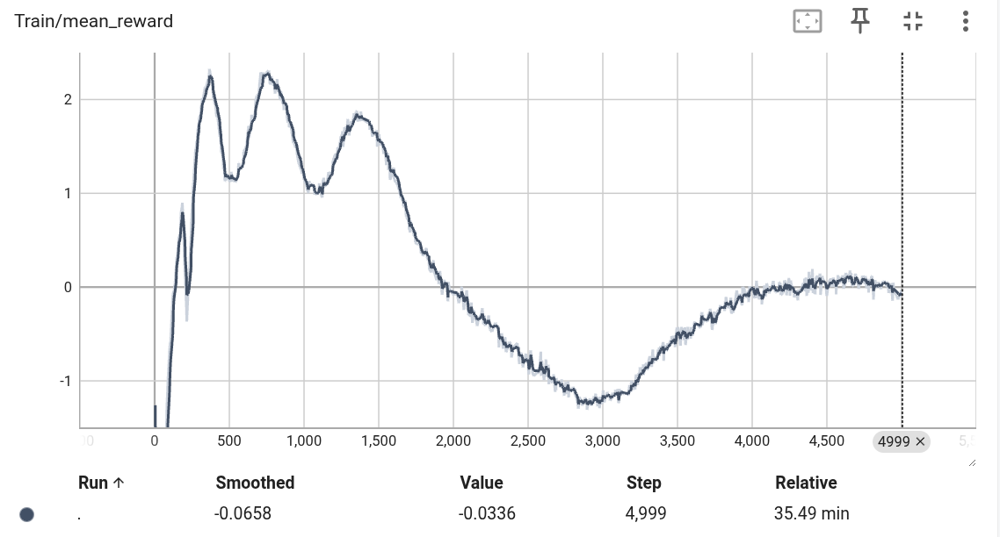
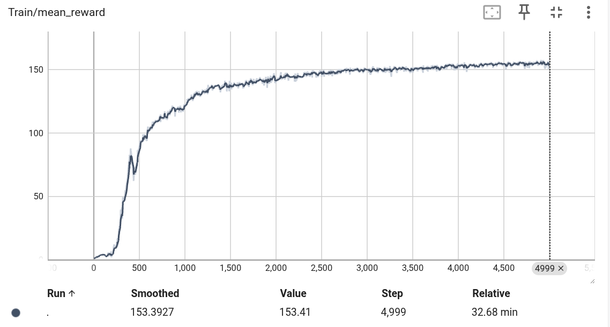
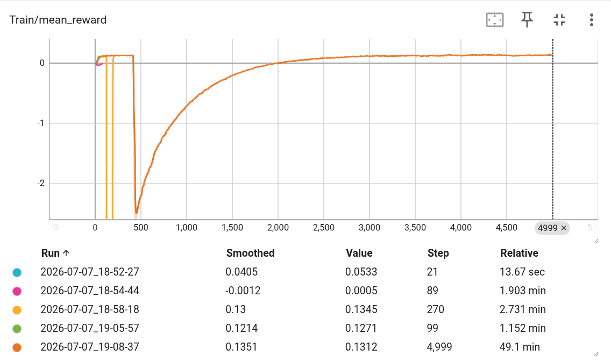

# 2026-07-07 OpenArm 작업 정리

이 문서는 2026년 7월 7일 OpenArm Isaac Lab 작업 중 GitHub에 반영한 핵심 변경만 정리한다.

## 1. USD 기본 장면 정리

- 로컬에서 최종 확정한 `openarm_test_v2.usd`를 GitHub의 기본 USD 파일인 `assets/openarm_test.usd`로 반영했다.
- GitHub에는 `openarm_test_v2.usd`라는 별도 이름을 추가하지 않았다.
- 즉, 저장소 기준 기본 장면은 계속 `assets/openarm_test.usd`다.
- 장면 구성은 로봇과 작업 테이블을 분리한 형태로 정리했다.
- 로봇은 낮은 받침 테이블 위에 위치하고, 바스켓이 있는 높은 테이블은 로봇 앞쪽 중앙에 배치했다.
- 높은 테이블은 바스켓과 물체 배치 공간을 확보하도록 가로 폭을 넓혔다.
- 로봇 색상과 로봇 asset 자체는 task 코드에서 수정하지 않았다.

## 2. Reach 튜토리얼 확인

- `Isaac-Reach-OpenArm-Bi-v0`는 pick-and-place가 아니라 양팔 end-effector가 목표 pose를 따라가도록 학습하는 reach task다.
- 이 task는 OpenArm bimanual articulation, joint action, reward 구성이 정상인지 확인하는 선행 튜토리얼로 사용했다.
- 5000 iteration 학습 후 TensorBoard에서 최종 mean reward가 약 `-0.03` 수준으로 수렴하는 것을 확인했다.
- `Isaac-Lift-Cube-OpenArm-v0`와 reward scale이 다르므로 두 그래프의 절대 reward 값을 직접 비교하면 안 된다.

## 3. Pick-and-place task 추가

새로운 task를 추가했다.

- `Isaac-PickPlace-OpenArm-TestUSD-Bi-v0`
- `Isaac-PickPlace-OpenArm-TestUSD-Bi-Play-v0`

추가된 주요 파일은 다음과 같다.

- `source/openarm_testusd_task/openarm_testusd_task/tasks/testusd_pick_place/__init__.py`
- `source/openarm_testusd_task/openarm_testusd_task/tasks/testusd_pick_place/testusd_pick_place_env_cfg.py`
- `source/openarm_testusd_task/openarm_testusd_task/tasks/testusd_pick_place/mdp.py`
- `source/openarm_testusd_task/openarm_testusd_task/tasks/testusd_pick_place/agents/rsl_rl_ppo_cfg.py`
- `source/openarm_testusd_task/openarm_testusd_task/tasks/__init__.py`

현재 PAP task는 오른손 중심의 첫 학습 버전이다.

- 오른팔 7개 joint만 joint position action으로 제어한다.
- 오른손 gripper만 binary open/close action으로 제어한다.
- 왼팔은 policy action space에서 제거해 기본 PD-held pose를 유지하도록 했다.
- 이전 15-action PAP checkpoint는 현재 8-action task와 호환되지 않는다.
- 학습 물체는 안정성 확인을 위해 큐브 1종으로 제한했다.

## 4. Reward와 종료 조건

Reward는 Isaac Lab lift MDP를 기반으로 구성했다.

- 오른손과 물체 위 pre-grasp 지점 사이 거리 보상
- 오른손과 물체 근접 grasp 지점 사이 거리 보상
- 물체 lifting 보상
- 물체가 목표 위치에 가까워지는 goal tracking 보상
- 오른손이 테이블 높이 아래의 낮은 경로를 지나갈 때 clearance penalty
- action 변화량 penalty
- joint velocity penalty

종료 조건은 다음과 같다.

- episode timeout
- 물체가 너무 낮게 떨어지는 경우
- 물체가 목표 위치에 들어온 경우

기존 lift MDP의 end-effector 거리 계산은 현재 USD 구조와 맞지 않는 부분이 있어, `mdp.py`에 `object_body_distance()`, `object_body_offset_distance()`, `body_height_below_minimum()`을 추가해 `openarm_right_hand` body pose를 직접 읽도록 했다.

## 5. PPO 안정화

초기 학습 중 `value_function loss: inf`와 `normal expects all elements of std >= 0.0` 오류가 발생했다.

이를 막기 위해 PPO 설정을 안정화했다.

- empirical normalization 활성화
- action noise를 log std 방식으로 변경
- learning rate를 `3e-5`로 낮춤
- fixed schedule 사용
- entropy coefficient 축소
- mini-batch와 epoch 설정 조정

이후 100 iteration headless 검증은 정상 종료했다.

## 6. 현재 학습 상태

PAP task의 학습 파이프라인은 정상 동작한다.

다만 5000 iteration 결과는 아직 pick-and-place 성공으로 보기 어렵다.

- 평균 reward는 약 `0.13` 수준으로 안정화됐다.
- `reaching_object` 보상은 생긴다.
- `lifting_object`, `object_goal_tracking`, `object_reached_goal`은 아직 0에 가깝다.

즉, 기존 5000 iteration 결과는 “오른손이 물체에 접근하는 초기 정책은 잡히지만, 집기와 운반은 아직 보상 설계와 초기 자세를 더 다듬어야 하는 단계”였다.

그 이후 확인된 문제는 다음과 같았다.

- 오른팔이 낮은 경로로 올라가며 테이블에 걸려 물체를 pick하지 못했다.
- 왼팔이 policy action에 포함되어 있어 뒤나 옆으로 불필요하게 움직였다.

이에 따라 PAP task를 수정했다.

- 왼팔 joint를 action/observation/reward penalty 대상에서 제거했다.
- `arm_action`은 오른팔 7개 joint만 제어한다.
- `gripper_action`은 오른손 gripper 1개 binary action만 사용한다.
- 오른손 위치를 observation에 추가했다.
- 물체 중심으로 바로 들어가는 reward 대신, 물체 위 pre-grasp point와 근접 grasp point를 분리했다.
- 오른손이 물체 x 좌표 쪽으로 전진하도록 `right_hand_forward_alignment` reward를 추가했다.
- 오른손이 로봇 기준 `x=0.40 m` 이상 전방으로 나가도록 `right_hand_forward_progress` reward를 수정했다.
- 오른손이 로봇 기준 `z=0.43 m` 이상으로 올라가도록 `right_hand_lift_to_pre_grasp` reward를 수정했다.
- 오른손이 로봇 기준 x 음수 방향으로 뒤로 빠지는 동작은 `right_hand_backward_guard` penalty로 약하게 막았다.
- 오른손이 `z=0.62 m` 아래로 내려가는 낮은 경로를 `right_hand_table_clearance` penalty로 막았다.
- 오른팔 ready pose를 FK 탐색으로 찾은 물체 위 pre-grasp 근처 관절값으로 변경했다.
- 오른팔 action scale을 `1.0`에서 `0.5`로 낮춰 ready pose 주변에서 과도한 충돌 동작을 줄였다.

추가로 21:30 학습 중간 점검에서 좌표계 버그를 확인했다. 기존 전진/후퇴 보상이 world 좌표를 기준으로 계산되어, `num_envs=1024` 복제 환경의 위치 때문에 실제 후퇴가 아닌데도 큰 후퇴 penalty가 들어갔다. 이를 로봇 root 기준 좌표 함수로 바꿨고, 20 iteration smoke test에서 `right_hand_backward_guard=0`, `right_hand_table_clearance=0`, 평균 reward 양수화를 확인했다.

이후 21:50 학습 중간 점검에서는 pre-grasp reward 포화 문제를 확인했다. 손은 안전하게 물체 위에 머물렀지만 `lifting_object`가 계속 0이라서, `PRE_GRASP_OFFSET_W`와 `RIGHT_HAND_TARGET_HEIGHT_B`를 낮추고 pre-grasp/height reward weight를 줄였다. 반대로 실제 grasp point 접근과 lifting을 강화하기 위해 `reaching_object`와 `lifting_object` weight를 높였다.

이후 300 iteration 검증에서 손 위치 보상은 상승했지만 `object_reached_goal`은 계속 0이었다. 이에 따라 손 프레임이 물체에 대략 접근하는 보상만으로는 부족하다고 판단했고, 더 좁은 grasp point 보상과 물체 근처에서 오른쪽 gripper를 닫는 보상을 추가했다. 또한 왼팔 비의도 움직임을 억제하기 위해 왼팔 joint position/velocity penalty를 추가했다.

## 7. 실행 명령

Headless 학습:

```bash
source /home/mh/isaac-stack-2.3.2/activate_isaaclab_2.3.2.sh
cd /path/to/OpenArm
python scripts/rsl_rl/train.py \
    --task Isaac-PickPlace-OpenArm-TestUSD-Bi-v0 \
    --num_envs 1024 \
    --device cuda \
    --max_iterations 5000 \
    --headless
```

GUI 확인:

```bash
source /home/mh/isaac-stack-2.3.2/activate_isaaclab_2.3.2.sh
cd /path/to/OpenArm
python scripts/rsl_rl/train.py \
    --task Isaac-PickPlace-OpenArm-TestUSD-Bi-v0 \
    --num_envs 16 \
    --device cuda \
    --max_iterations 200
```

Checkpoint 실행:

```bash
source /home/mh/isaac-stack-2.3.2/activate_isaaclab_2.3.2.sh
cd /path/to/OpenArm
python scripts/rsl_rl/play.py \
    --task Isaac-PickPlace-OpenArm-TestUSD-Bi-Play-v0 \
    --num_envs 16 \
    --device cuda \
    --checkpoint logs/rsl_rl/openarm_testusd_bi_pick_place/<run>/model_<N>.pt \
    --real-time
```

## 8. 첨부 이미지

오늘 캡처한 TensorBoard 이미지를 함께 첨부했다.

### OpenArm bimanual reach 학습 결과



### Isaac Lift Cube 비교 그래프



### OpenArm TestUSD pick-and-place 학습 결과



## 9. GitHub에 포함하지 않은 것

다음 항목은 저장소에 넣지 않았다.

- Isaac Lab 원본 소스 수정분
- Isaac Sim 설치 파일
- ROS2 workspace
- 학습 로그 전체
- TensorBoard event 파일
- checkpoint `.pt` 파일
- Python cache 파일
- 임시 검사 스크립트
